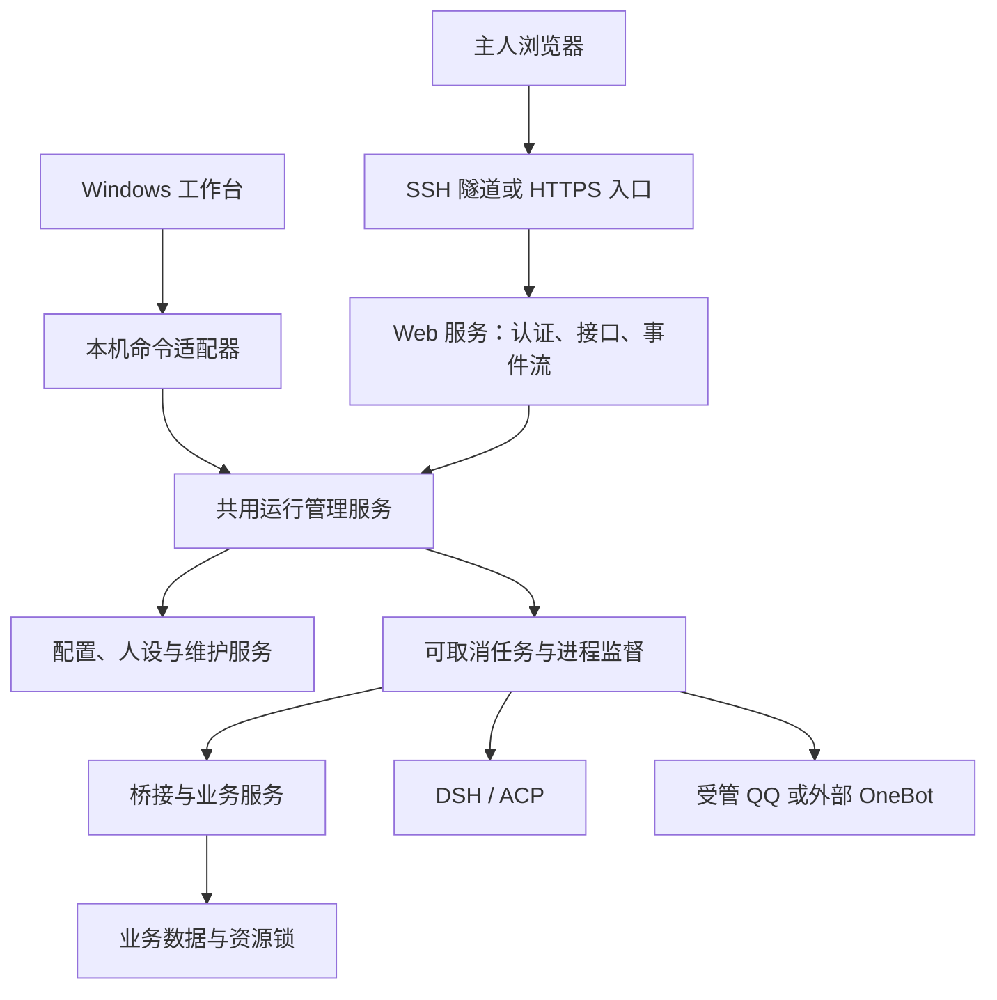

# 云服务器与浏览器控制台方案

更新日期：2026-10-27。对应[产品化方案](product-readiness-plan.md)和[实施进展](implementation-status.md)。

首发范围更新（2026-10-28）：按正式发行精简方案，网页控制台扩展、云端与 Linux 发行整体后置；已有源码保留，不作为本轮 Windows 首发承诺或发布前置任务。后续重新启动本方案时再单独安排范围及验收资源。

本文是独立的实施方案。当前已有共用管理核心、私有网页认证、配置与受限任务，见[当前使用说明](cloud-console.md)；Linux QQ 组件、完整网页操作及云端发行仍待实现。按 2026-10-27 的最新决定，云端专属开发与验收放到 Windows 本地项目完善之后，已有实现保留。下面未在进展中标记完成的接口、目录和验收数字都是设计目标，不能据此认为当前 Windows ZIP 可以部署到 Linux。

## 目标与首版范围

机器人在云服务器上持续运行，主人用浏览器完成配置、查看状态、管理人设记忆、处理申请及维护。关闭浏览器或本地电脑后机器人继续工作；页面断线后能恢复状态，不能把浏览器会话当成机器人生命周期。

首版按个人、单主人、单 QQ 账号、单数据实例设计。用户已确认首个云端目标为 Linux x64；Windows Server 复用管理核心，另做服务托管验收。实际部署前再确认具体发行版、域名和网络条件。ARM、多租户、公开注册及多人协作不属于首版。

优先完成仅能通过 SSH 隧道访问的控制台，再提供有域名的 HTTPS 部署。项目继续采用 MIT；NapCat 和其它组件按各自许可获取及使用，仍限本项目已确认的个人使用定位。

## 共用管理核心

从 `desktop/host.mjs` 提取进程管理、诊断、任务调度与事件分发；从配置工作进程提取可独立调用的管理服务。保留现有桌面消息契约，由适配器转换请求。HTTP 路由使用明确的请求和响应结构，不直接公开本机命令分发器。

同一实例的桌面与网页连接同一个管理服务。服务持有实例管理租约，本机适配器通过受限命名管道或 Unix socket 接入；第二个管理服务只能连接既有实例或明确拒绝，不能各自启动一套桥接。已有业务数据资源锁继续保留，管理租约不能代替业务互斥。

当前配置加载会向可信桌面返回原始 `.env`；Web 接口必须重新定义只包含允许字段的响应，不能复用这份结果。浏览器也不获得任意服务器路径、进程命令或环境变量。

| 层 | 职责 | 关键约束 |
| --- | --- | --- |
| 共用运行管理服务 | 生命周期、就绪状态、任务、诊断、配置与维护 | 一个实例只有一个管理者；所有入口执行相同策略 |
| WPF 适配器 | 现有窗口、路径选择、本机消息传递 | 保持当前交互和数据位置兼容 |
| Web 服务 | 登录、会话、结构化 API、静态资源、事件订阅 | 逐项授权、请求大小限制、响应脱敏 |
| 业务桥接 | 聊天、账号动作、审批、记忆与额度 | 在线管理通过受控 IPC 调用；离线写入先取得资源锁 |
| 操作系统托管 | 开机启动、服务退出恢复、日志与磁盘限制 | 使用专用普通账户；页面无系统管理员权限 |

技术选型拟采用 Node 24、TypeScript、Fastify 和 React；具体依赖版本在实施时核对许可、兼容性并锁定。选择 Fastify 是为了统一接口结构校验和响应序列化，网页使用 React 组织配置与状态组件；业务规则保留在共用服务中。这是项目设计选择，参照 [Fastify 校验与序列化文档](https://fastify.dev/docs/latest/Reference/Validation-and-Serialization/)和 [React 组件文档](https://react.dev/learn)，不表示这些框架自动提供完整权限保护。

## 页面与使用流程

首屏直接显示「QQ 是否登录」「模型是否可用」「桥接是否就绪」及当前阻塞原因。进程已启动、接口可达、登录成功和实际可聊天分别记录，启动按钮的成功响应不代替业务就绪。

| 页面 | 首版操作 |
| --- | --- |
| 总览 | 启动、停止、重连模型、检查连接、查看最近故障与恢复任务 |
| 首次配置 | 组件准备、模型凭据、QQ 登录、联系范围、检查并开始 |
| 连接与模型 | 更换模型/地址/密钥，验证草稿，保存后按影响范围重启 |
| 人设与记忆 | 全局/会话人设、记忆来源与版本、编辑冲突提示 |
| QQ 管理 | 资料、头像、真实好友/群申请、账号动作结果核对 |
| 活动与维护 | 有界日志、任务取消、备份、恢复、清理、脱敏诊断 |

首次部署由服务器上的初始化工具生成短期、一次性的主人认领凭据，只在初始化终端显示；不写访问日志、不放 URL、不采用默认密码。网页认领后设置独立管理凭据，认领入口立即关闭。凭据遗失时，通过服务器本地恢复命令撤销旧会话并重新认领；恢复不依赖 QQ 消息或模型判断。

新用户进入向导后，先检查组件及网络，再填写模型凭据并主动测试；模型测试会明确提示使用本人额度。随后完成 QQ 登录和允许联系范围，只有各项检查通过后才显示「可以开始」。模型故障时单独恢复模型，QQ 保持登录；QQ 未登录时页面给出真实状态。

二维码与登录状态必须由固定版本的 QQ 适配器提供，登录图像仅在认证后的短期接口返回，禁止缓存。实施前先验证上游实际接口和失效语义；没有经过验证的接口就不把扫码能力列为完成。需要额外验证时解释阻塞原因，不把账号验证失败当成网络重试。NapCat 官方已经提供 Linux 安装路径，但这只说明上游存在 Linux 部署方式，不能替代本项目的无人值守与登录验收。[NapCat 官方 Shell 文档](https://napneko.github.io/guide/boot/Shell)

## 远程认证与权限

HTTPS 模式使用服务器端会话和随机会话标识，Cookie 设置 `Secure`、`HttpOnly`、`SameSite=Strict`；不把长效管理令牌放在浏览器本地存储。登录后轮换会话，退出、改密和恢复操作立即撤销会话及事件订阅。所有写操作验证 CSRF 与精确 Origin，SameSite 不能代替 CSRF 校验。这些会话设计依据 [OWASP 会话管理建议](https://cheatsheetseries.owasp.org/cheatsheets/Session_Management_Cheat_Sheet.html)。

初版私有模式只监听回环地址，通过 SSH 隧道访问；若显式启用回环 HTTP，使用独立 Cookie 名并验证回环 Host/Origin，不能携带这套配置改为对外监听。公网模式必须配置受信代理和外部 HTTPS Origin，否则拒绝启动公网监听；不信任任意来源的转发头。

管理密码仅存带随机盐和可升级参数的口令哈希。拟定默认值为认领凭据 15 分钟有效、会话空闲 30 分钟/最长 12 小时；登录按来源和账号限速，失败提示不泄露账号是否存在。公网发布前加入二次验证与本机恢复码，恢复码只显示一次且只存哈希。聊天、模型输出、日志和文件名均按不可信文本渲染，富文本须清理并配置 CSP，不能把消息里的 HTML 当作界面内容执行。

| 来源 | 权限归属 |
| --- | --- |
| 已认证网页主人 | 本实例管理能力；危险操作需重新验证身份及具体内容 |
| 可信本机控制台 | 保留本机管理能力，写入同一审计记录 |
| QQ 主人真实消息 | 沿用已实现的主人规则和工具策略 |
| 普通群友、通知、后台模型 | 不获得网页管理能力，也不能处理账号级申请或资料 |

网页身份由认证服务生成，不能接受请求正文中的 `isAdmin`、QQ 号或模型输出作为认证。危险确认绑定动作、目标、正文或文件摘要、配置版本与有效期；执行前再检查登录状态、账号、权限和目标。启动/停止机器人、账号操作和整库恢复分别授权，不提供通用 Shell、终端、脚本执行或任意文件浏览 API。

接口只返回密钥是否已配置及更新时间。密钥更新采用独立写入口，空值与「保留原值」「清除」分别表达；错误和日志不回显原值。磁盘凭据先由专用账户文件权限保护，不能把同目录存放的加密密钥宣传成独立的密钥保护。备份包含凭据时必须加密并明确提示。

模型地址、媒体服务和外部 OneBot 的连接测试由允许列表及网络策略约束。默认只允许预设公共服务和明确配置的本机依赖；启用自定义地址需主人显式配置目标，校验协议、重定向和实际解析地址，避免测试入口成为任意内网请求代理。

## 接口、任务与状态

下表为拟定接口契约，当前不可直接调用。所有路径都必须经过认证；只有初始化和登录的必要接口例外。

| 接口 | 语义 |
| --- | --- |
| `GET /api/v1/status` | 进程、登录、连接、就绪及容量的结构化状态 |
| `GET /api/v1/config` | 脱敏配置与修订号，不返回原始环境文件 |
| `PATCH /api/v1/config` | 允许字段及预期修订号；版本冲突返回 409 |
| `PUT /api/v1/secrets/:name` | 仅允许的密钥名；响应不含原文 |
| `POST /api/v1/runtime/start` / `stop` | 幂等生命周期请求，禁止任意命令参数 |
| `POST /api/v1/components/:id/prepare` | 固定平台/版本的准备任务，不接受任意下载 URL |
| `POST /api/v1/qq/requests/:id/resolve` | 根据真实申请记录处理并核对动作结果 |
| `GET /api/v1/jobs/:id` / `POST .../cancel` | 长任务状态与取消，取消消息独立调度 |
| `GET /api/v1/events` | 认证后的单向事件流，重连可以恢复状态 |
| `POST /api/v1/backups` / `restore` | 静默写入后备份或验证后恢复，互斥执行 |

首次长任务响应返回 202 与任务编号。任务记录阶段、进度、错误类别和可重试条件；刷新页面不会重新提交任务。带外部副作用的操作使用幂等标识，结果不明时进入「待核对」，不自动重发好友处理、消息或空间内容。

首版用 SSE 推送状态、脱敏日志和任务进度，操作仍走 HTTP，避免增加双向命令通道。每个连接限制缓冲，慢客户端断开并重新获取快照；日志有条数、总字节和文件轮换限制。会话失效同时断开订阅，事件编号不含密钥和消息正文。

初始容量目标为每会话最多 2 条事件连接、每连接最多 64 KiB 待发送数据；普通管理 JSON 默认限制 64 KiB，人设文本单独限制 256 KiB。组件与恢复文件使用独立上传接口、临时落盘、类型/摘要及解压预算校验，同实例最多一个维护任务；上传不进入普通 JSON 解析器。具体值通过压力测试调整，但所有路径必须有明确上限。

如后续引入 WebSocket，握手验证认证及精确 Origin，连接限额、单帧大小和会话撤销同样执行；每条管理指令仍重新授权。相关边界参照 [OWASP WebSocket 安全建议](https://cheatsheetseries.owasp.org/cheatsheets/WebSocket_Security_Cheat_Sheet.html)，不直接透传现有 OneBot WebSocket。

## 部署与运行目录

原生 Linux 服务先采用独立服务账户和系统服务托管。程序只读、数据可写，示意目录为 `/opt/whale-workbench/releases/<version>/` 与 `/var/lib/whale-workbench/`；真实路径由启动契约选择。组件、QQ/DSH 登录、配置、存储和日志均进入数据目录，禁止写进发行目录。Windows Server 使用相同逻辑，由适配器提供服务托管与数据路径。

Linux 组件使用独立的平台清单、来源、摘要、适配器和兼容测试；不复用 Windows ZIP 或 DLL。第一阶段可连接已运行的外部 OneBot，受管 Linux QQ 必须通过固定版本安装、登录和恢复验收后才能作为默认。DSH 原生模块、QQ 系统库、字体及媒体能力逐项验证，缺失时页面说明不可用原因。

公网入口拟由 Caddy 提供 HTTPS 和同源静态页面，后端仅监听本机。Caddy 的自动证书签发和续期仍要求域名及验证条件满足，不能承诺输入任意 IP 就有受信证书。[Caddy 自动 HTTPS 文档](https://caddyserver.com/docs/automatic-https)

| 端口/通道 | 计划可达范围 |
| --- | --- |
| Web 管理后端 | 本机回环，SSH 隧道或受信反向代理接入 |
| HTTPS 入口 | 用户选择公网部署时才开放，仍需主人认证 |
| OneBot HTTP / 正向 WS | 本机或明确的私有网络，单独令牌 |
| NapCat WebUI | 本机或私有维护通道，不直接开放公网 |
| 应用内部动作/进程 IPC | 本机、随机实例凭据，不与网页会话混用 |

Docker Compose 在原生服务通过后再提供，镜像版本与摘要固定、应用使用普通用户、持久卷只映射所需数据。管理服务不挂载 Docker socket，也不获得宿主机管理权限；容器重建由部署工具负责，网页管理的是应用内受管进程。若拆分 QQ 容器，须额外实现权限受限的进程控制协议，不能假设网页天然能够重启另一容器。

Compose 只将必要 Web 入口发布到回环或反向代理网络；OneBot 与 NapCat 管理口保持私有。Docker 的端口发布可能对外可达，部署模板必须显式写出绑定地址，并实际从外部网络验证访问范围。[Docker 端口发布文档](https://docs.docker.com/engine/network/port-publishing/)

## 监督、升级与恢复

系统服务负责管理服务本身的退出恢复；应用监督器分别管理桥接、DSH 和 QQ。使用退避、最大次数与时间窗口，稳定运行后才重置失败计数。权限错误、错误密钥、需要账号验证等情况停止自动重启，页面给出人工处理入口。

网页连接中断不停止机器人；管理服务退出时按约定停止子进程并排空写入，强退由资源锁与恢复检查处理。单纯依赖端口仍开着不能判断实例归属，也不能结束外部 OneBot。停止与取消必须能绕过耗时安装/测试的任务队列。

升级先进入维护状态，停止写入并生成一致备份，校验新程序与存储兼容后再切换版本。迁移只执行一次，备份与恢复排斥在线写入；SQLite 迁移完成后采用数据库一致性备份，不能在运行中随意复制数据库主文件。失败保留旧程序及原数据，不承诺把已迁移数据库直接交给不兼容旧版本。

提供独立的本机恢复路径：撤销网页凭据、检查资源锁、列出备份、验证恢复目标、恢复数据并重新启动。网页服务损坏时也能恢复，恢复工具不上传聊天或密钥。资源预算、磁盘水位和日志保留采用实测后给出的默认值，首版不在没有压测的情况下宣称某个云主机规格可承载多少群。

## 实施顺序与完成条件

| 阶段 | 交付物 | 进入下一阶段的条件 |
| --- | --- | --- |
| W01 共用核心 | 提取管理服务，WPF 适配层保持原行为 | 现有回归与桌面原生冒烟通过；共享数据互斥保持有效 |
| W02 私有只读控制台 | 主人认领、会话、脱敏状态/配置、日志与事件恢复 | 未登录、过期会话及跨站请求不能读取管理数据 |
| W03 配置与任务 | 修订号编辑、密钥写入、测试/启停/组件准备/取消 | 错误与取消不覆盖配置或旧组件；多标签冲突可解释 |
| W04 QQ 与账号管理 | 固定版本登录适配、真实申请与资料界面 | 主人权限、内容绑定确认、结果不明不重发均通过 |
| W05 云端发行 | Linux 原生部署、服务托管、HTTPS 模板、备份恢复 | 无桌面环境完成首轮聊天；重启与升级保留登录和数据 |
| W06 发布验收 | 干净机器、故障注入、持续运行、使用说明 | 以下门槛全部达到后才称为云端可用版本 |

W01 可以在当前桌面升级过程中逐步推进；W04 依赖产品化方案中的 S01/S02 与 D03。W05 的正式恢复依赖存储迁移契约。Docker、Windows Server 服务托管和公网模式分别留存验收记录，不能互相替代。

拟定发布门槛：

1. 在干净 Linux x64 环境按公开说明安装，主人无需改源码即可完成组件准备、QQ 登录、模型测试与首轮聊天。
2. 没有认证、会话过期、恶意 Origin、重复请求、超大载荷和慢客户端均不能造成越权或无界积压；密钥不出现在响应、事件、诊断包和访问日志中。
3. 关闭浏览器、断网重连、管理服务/桥接/DSH/QQ 分别退出后，状态准确、恢复有上限；外部副作用结果不明时不重复执行。
4. 完成双标签编辑冲突、组件中断、磁盘不足、只读目录、备份与恢复、迁移失败回退和本机凭据恢复演练。
5. 以预先固定的合成负载进行至少 72 小时观察，记录内存、磁盘、事件循环、入站拒绝和恢复次数；单独使用测试账号完成真实 QQ/模型验收，记录服务额度与账号验证限制。
6. 从服务器外部验证公网/私有端口边界；公开文档列出实测平台、组件版本、未通过项和升级方法。

以上是完整云端交付的验收目标。当前已实现本机运行基础、资源锁、账号权限首轮、Windows 组件/内部发行包、共用管理核心和私有网页认证/配置/任务基础；实际验证和本地优先排期见[实施进展](implementation-status.md)。
