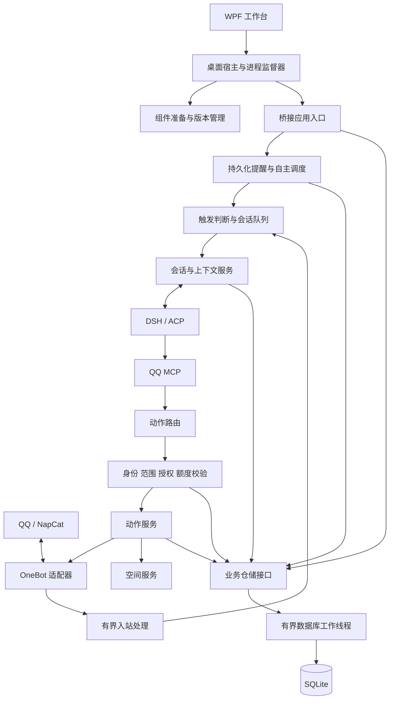

# 小鲸工作台产品化优化方案

编制日期：2026-10-26。代码基线：`ef72bcc`，项目版本 `0.2.0`。

进度更新：2026-10-28，按用户要求暂停开发并记录交接。最近完成并提交的代码检查点为 `ec4bb6b`；其后的媒体引用索引代码保留在工作区，尚未提交或完成专项验收。

本文保留原始交付目标和验收条件，并记录实施进度。目标是让没有开发经验的 Windows 用户下载后，通过图形向导配置模型、登录 QQ，完成日常使用、升级和故障恢复。文中的性能数字、完成条件和工期均为拟定目标；已执行的验证单独注明。

分阶段完成情况与实际验证见[实施进展](implementation-status.md)。

云服务器部署与浏览器控制台作为独立扩展方案维护，见[云端控制台方案](cloud-console-plan.md)。已有共用核心和私有网页管理基础；按 2026-10-27 的最新决定，先完成 Windows 本地版，云端专属实施与验收放到本地成品之后。

## 当前进度与暂停交接

当前仍为内部验证阶段，Windows 本地版全部交付与验收尚未完成。改造位于独立工作区 `QQ-BOT-upgrade`，原 `QQ-BOT` 目录未切换。以下“首轮完成”表示已有实现及对应隔离验证，不能代替完整工作包或正式发行验收，也不按测试数量折算完成百分比。

| 工作包 | 当前状态 | 已完成内容与剩余边界 |
| --- | --- | --- |
| B01 | 部分完成 | 原始回归、可重复存储诊断、固定组件与兼容探针已有；完整新机器链路和正式性能报告未完成 |
| D01–D04 | 本地首轮完成 | 程序/数据目录隔离、受管组件、模型/QQ 登录及有限联系人向导已有；新包与干净机器全程验收未完成 |
| S01–S02 | 关键边界首轮完成 | 真实身份、角色/目标/正文绑定确认、DSH 工具与请求预算守卫、Windows DPAPI 已接入；本机账号专用操作界面及新包完整验收仍待补齐 |
| L01–L02 | 首轮完成 | 共用资源锁、入站/模型队列/Worker 条数与字节限制、审批优先已验证；管理 IPC 全部列表/详情边界和混合负载验收仍待完成 |
| A01 | 部分完成 | 会话服务、事务动作服务和可信动作分派已提取；启动、提示词、ACP 与入站编排仍需拆分 |
| A02 | 工具分组首轮完成 | 四十个社交工具分为九组，登记完整性检查与十一个兼容工具共同接受全部五十一个工具审计；后续契约继续随服务拆分验证 |
| P01–P02 | 首轮完成 | 仓储接口与四类 SQLite Worker 仓储、有界请求、索引及增量写入已接入；后续新增索引仍须迁移和故障验证 |
| P03 | 迁移首轮完成 | 旧 v1/v2、自定义路径、原文摘要备份、暂存校验及中断保护已实现；完整维护恢复入口尚未闭环 |
| P04 | 首轮完成 | 共享额度与逻辑动作事务、实际 QQ 提交去重、入站持久去重及提醒/自主/学习领取已接入；未知结果保留并禁止自动重发 |
| C01 | 首轮完成 | 模型/媒体/学习/原生联网调用预算、并发、输出上限及真实/未知用量记录已有；长期负载和能力展示仍须整体验收 |
| R10 | 首轮完成 | Job 进程树、监督器、有界恢复和错误分类已有；最新完整组件故障矩阵和长期观察未完成 |
| R11 | 部分完成 | 任务领取、取消凭证保护、后台轮转及扫描/判断单调间隔已实现；学习游标回拨、各能力冷却、失败退让和实际睡眠恢复仍待完善 |
| R12 | 部分完成 | 确认关闭后的会话淘汰、媒体大小索引/事务预留/保存恢复、有界视频管道已提交；引用索引处于未提交开发状态，引用保护与保留期清理未验收、未启用普通缓存自动删除 |
| U01 | 部分完成 | 就绪状态、能力和故障提示及部分修复入口已有；全部列表分页/懒加载、管理 IPC 和用户操作闭环未完成 |
| U02 | 未闭环 | 已有社交离线检查/私有导出与 SQLite 一致性备份原语；四库、配置、凭据和必要媒体的一致备份/恢复、默认脱敏诊断包及界面未完成 |
| T01 | 本地验证持续通过 | Windows 回归、原生窗口、真实固定 DSH/Node 探针已有；远端 CI 配置的实际运行结果和物理托盘点击仍待验证 |
| T02 | 未验收 | 短串行存储诊断不能代替三档数据各三轮、每轮三十分钟的混合负载及故障/泄漏报告 |
| T03 | 未验收 | 最新候选包真实兼容、干净 Windows 10/11、72 小时及 7 日观察、五位新用户试用均未完成 |
| F01 | 内部包基础完成 | 目录/ZIP 构建和固定依赖已有；旧 `rc3` 不代表最新代码，新包、用户级安装、可信签名更新清单及程序/数据配对回退未完成 |
| F02 | 部分完成 | 帮助、许可和开发/存储说明持续更新；仍需与最终发行包、维护恢复能力逐项对齐 |

最近完整验证对应检查点 `ec4bb6b`：Windows / Node 22.20.0 全量 **437 项通过，0 失败、0 跳过**，包含显式启用的真实 FFmpeg 7.1 合成视频验证；固定发行 Node 24.22.1 的视频、媒体索引和实际协议专项 **30 项通过**。第二十九批完成媒体容量索引与中断恢复，第三十批完成视频管道、并发和取消关闭。当前这两批均未向真实 QQ 发送消息或调用付费模型。

暂停时保留的下一批代码包括 schema 9 媒体引用表、随社交/动作写入更新引用、分批后台回填、动作关联文件登记及桥接接入；类型检查、构建和相关隔离回归 **26 项通过**。这些结果只证明初步兼容，尚未有引用专项测试、该工作区版本的全量回归或清理并发验证，不能将上面的 437 项结果归给未提交代码，也不能将 schema 9 当作已交付迁移。

恢复开发时先审查和完成这批引用索引的契约、回填/重启/容量及未知动作保护测试，再实现受保护、可取消且让出前台资源的清理；随后继续时钟边界、应用拆分/管理载荷、完整维护恢复、安装升级回退与新候选包，最后执行 T02/T03 和第 13 节门槛。

当前仅有本地电脑，无干净测试机或虚拟机；缺少设备不豁免验收。真实验收已有独立测试实例及付费模型使用授权，QQ 首个允许收发对象为用户指定的好友；具体账号仅保留在本机会话与私有验收配置，不写入公开方案。既有授权在恢复时继续适用，实际收发须使用新候选包并记录结果。

## 1. 成品的定义

### 1.1 用户拿到的内容

首次正式交付提供 Windows x64 发行包和中文快速使用说明。先完成可解压运行的完整发行包，再以同一套运行文件制作用户级安装程序。发行包自带经过验证的 Node 运行库、已编译的桥接、生产依赖、WPF 工作台和默认模板。用户不需要安装 Git、npm、TypeScript 或编译工具。

用户首次使用只需完成以下流程：

1. 下载并打开小鲸工作台。
2. 由向导检测、准备运行组件；界面显示下载进度、来源和重试入口。
3. 填写模型 API Key，或选择向导实际支持的账号/Profile 方式，点击测试。
4. 按提示登录 QQ；选择允许聊天的好友和群。
5. 点击开始，看到 QQ 在线、模型可用，并完成一轮真实聊天验证。

DSH 路径、NapCat DLL、端口和配置文件由程序管理。已有 OneBot、自定义 DSH、媒体服务和高级配置继续提供，但放在高级设置中。

QQ 账号、有效模型凭据、网络连接及登录验证是用户必须提供的条件。需要 QQ 官方客户端时，程序自动检测；缺失时提供明确的官方安装入口并在安装后继续检测。能否随发行包分发 DSH、NapCat 和相关运行组件，须在 M0 逐项核实；不具备分发条件的组件使用向导从官方渠道获取。不能把尚未验证的自动部署写成已实现能力。

### 1.2 可判定的交付标准

| 用户场景 | 必须达到的结果 |
| --- | --- |
| 新机器无开发环境 | 不运行命令行即可完成组件准备、配置和首轮聊天 |
| 已安装 QQ / 已有 OneBot | 自动检测或通过高级入口复用，不误结束外部服务 |
| 下载失败、空间不足、组件被拦截 | 明确指出失败阶段，支持修复后继续，不要求重新填写所有配置 |
| 密钥错误、QQ 未登录 | 分别提示原因，不能用“已启动”代表“已经可聊天” |
| 软件升级 | 人设、记忆、提醒、配置和额度保留；失败可恢复到升级前状态 |
| 模型或桥接异常退出 | 界面解释状态，符合条件时自动恢复，连续失败后停止重试 |
| 非管理员发起账号级操作 | 执行层拒绝或走所有者授权流程 |
| 多开程序或命令行 | 同一数据资源仅允许一个写入者，第二个实例不能覆盖数据 |
| 运行数日、消息增多 | 内存、磁盘和响应时间受控，后台任务不拖慢正常聊天 |
| 遇到问题求助 | 用户能导出默认脱敏的诊断包，无需复制聊天数据库或密钥 |

### 1.3 第一版支持范围

- Windows 10/11 x64、单机、单机器人账号、一个数据实例；多账号使用独立实例目录。
- 保留 WPF、TypeScript、DSH/ACP、NapCat/OneBot 和 MCP 的现有组合。
- 基础聊天、现有人设/记忆/表情/提醒能力属于回归范围；媒体和空间按实际依赖提供。
- 新增安装默认先完成基础聊天，自主活动、空间互动等由所有者按需开启。
- 保留自主聊天、安静收藏、空间创作及好友空间互动的产品方向，同时明确可执行的对象、动作和预算。
- 第一版优先完成 Windows 成品交付；多平台、插件市场、多租户、分布式部署和向量数据库列为后续需求。

## 2. 参考项目与采用方式

调研只采用项目自己的仓库、源码和官方文档。以下是局部设计参考，并非对参考项目安全性、性能或所有功能的完整背书。借鉴内容采用独立实现；复制代码或分发第三方组件前须核对其 LICENSE 和分发条件。

| 项目及查阅依据 | 已核实的做法 | 本项目采用的方式 |
| --- | --- | --- |
| [AstrBot 流水线顺序](https://github.com/AstrBotDevs/AstrBot/blob/832fc6d98ac25facd54b07424c16067435c118e6/astrbot/core/pipeline/stage_order.py)、[限流阶段](https://github.com/AstrBotDevs/AstrBot/blob/832fc6d98ac25facd54b07424c16067435c118e6/astrbot/core/pipeline/rate_limit_check/stage.py) | 唤醒、白名单、会话状态、限流、处理及回复分阶段组织 | 建立有界入站流水线，在模型请求前完成联系范围、容量和请求预算检查 |
| [AstrBot Desktop 架构](https://github.com/AstrBotDevs/AstrBot-desktop/blob/main/docs/architecture.md) | 桌面运行时划分启动计划、路径、后端管理、退出重启和更新职责 | 提炼运行组件管理、就绪检测和监督器，保留现有 WPF 技术栈 |
| [LangBot 架构](https://github.com/langbot-app/LangBot/blob/029fbbf3c359f3ef020c64ff20e1c2666006b895/ARCHITECTURE.md) | 消息流水线、服务层与持久化分工，SQLite 作为默认存储之一 | 业务接口统一服务化，桌面和 MCP 共用策略；采用本地事务存储 |
| [MaiBot 数据库实现](https://github.com/Mai-with-u/MaiBot/blob/062d45cf8bd4272ac57d7ec03fcf405e5a458211/src/common/database/database.py)、[迁移编排](https://github.com/Mai-with-u/MaiBot/blob/062d45cf8bd4272ac57d7ec03fcf405e5a458211/src/common/database/migrations/manager.py) | SQLite、查询索引，以及独立的版本迁移编排 | 社交数据增量写入、保留可核验迁移记录，维护会话与时间索引 |
| [NoneBot2 权限实现](https://github.com/nonebot/nonebot2/blob/master/nonebot/permission.py) | 从真实事件身份判断超级用户，权限检查独立建模 | 角色来自可信消息事件和本地所有者身份，禁止工具参数自报管理员 |
| [Koishi 生命周期](https://koishi.chat/zh-CN/guide/plugin/lifecycle) | 加载、停用时管理事件、定时器和服务等副作用 | 为桥接、调度器、适配器提供统一启动、停止、取消与资源回收接口 |

前三个主项目源码链接已固定提交；AstrBot Desktop、NoneBot2 和 Koishi 文档按 2026-10-26 查阅，分支或文档内容以后可能变化。实施时将实际依赖版本另写入组件清单。

这些参考支持职责划分，本文的权限矩阵、队列容量、性能目标和实施顺序是针对小鲸现状提出的设计，不声称参考项目采用相同参数。

## 3. 原始基线与问题分级

### 3.1 原始基线已有基础（`ef72bcc`）

- 编制时基线 `npm test`：228 项通过，0 失败、0 跳过；测试使用隔离夹具。当前结果见本文开头与实施进展。
- 已有同会话串行、全局并发限制、轮次超时、WebSocket 心跳重连及 QQ 动作额度。
- 已有首次配置向导、人设管理、记忆来源/版本、自主行为记录和部分迁移保护。
- 当前联网已统一交给 DSH 原生工具；空间浏览评论已内置并复用 NapCat 登录。
- README 和开发说明仍有已移除的静态网页解析依赖及 `web-service` 旧文案，F02 统一纠正，避免新用户按过时说明部署。

### 3.2 原始问题登记

本表保留制定方案时的问题及优先级；部分问题已完成首轮修复，当前状态以上方工作包进度为准，不能把本表当作全部仍未实施。

| 编号 | 优先级 | 当前问题与影响 | 对应工作包 |
| --- | --- | --- | --- |
| R01 | P0 | 普通用户仍需准备开发依赖、运行组件和本地构建产物 | D01–D04、F01 |
| R02 | P0 | 默认联系范围与自主执行策略开放，账号级动作缺少独立角色隔离 | S01–S02 |
| R03 | P0 | JSON 存储缺少跨实例写入保护，共用资源可能覆盖记录和额度 | L01、P03–P04 |
| R04 | P0 | 社交数据全量复制、校验、落盘；归档发生在模型队列容量控制之前 | P01–P03、L02 |
| R05 | P0 | 模型/桥接退出缺少完整监督恢复；升级恢复尚未形成用户闭环 | R10、F01 |
| R06 | P0 | 依赖审计、组件兼容、清洁机器安装和连续运行尚未形成发布门槛 | B01、T01–T03 |
| R07 | P1 | 核心编排集中在 bridge 和 social-engine，变更影响范围较大 | A01–A02 |
| R08 | P1 | 自主、提醒、媒体和原生工具缺少完整的资源预算与可用性表达 | C01、R11–R12、U01 |
| R09 | P1 | 普通用户缺少便捷的备份、清理、修复和脱敏求助路径 | U02、F02 |

P0 指正式交付前必须关闭的缺口；P1 同样纳入本方案，允许在前置工作完成后推进。发布门槛以第 13 节为准，不仅看任务数量。

### 3.3 历史性能诊断

上一轮代码审查对旧基线做过合成数据诊断：

| 存档消息数 | JSON 大小 | 单条 record 平均耗时 |
| ---: | ---: | ---: |
| 1,000 | 1.3 MiB | 13.8 ms |
| 10,000 | 12.7 MiB | 89.8 ms |
| 50,000 | 63.4 MiB | 735.9 ms |

5 万条时观察到约 469 ms 的事件循环延迟。该测量每档仅记录 5 条新消息，属于瓶颈定位，不能当作当前分支吞吐承诺或完整压力测试。B01 必须保留可重复的脚本，在当前版本和改造版本上使用同一数据、硬件与统计口径重测。

## 4. 目标架构与边界

采用单机模块化架构。桌面负责用户交互、运行组件与进程管理；桥接负责消息和业务编排；数据库工作线程负责存储；DSH 负责模型会话；QQ 适配器负责协议调用。



拟新增模块如下，名称可随实施小幅调整，职责必须保持：

| 位置 | 职责 |
| --- | --- |
| `src/app/bootstrap.ts` | 依赖组装、启动与停止；入口保留 `dist/bridge.js` |
| `src/app/message-pipeline.ts` | 入站准入、顺序、触发、聚合与会话排队 |
| `src/app/conversation-service.ts` | 会话创建、恢复、换代、取消与失活淘汰 |
| `src/agent/acp-client.ts` | ACP 协议、更新流和进程就绪边界 |
| `src/security/` | 身份、授权、能力清单与凭据来源管理 |
| `src/storage/` | 仓储、数据库工作线程、schema 版本和导入迁移 |
| `src/qq/handlers/` | 按消息、记忆、媒体、提醒、空间等职责分组的工具处理器 |
| `desktop/components.mjs` | 受管组件检测、下载、校验、安装与版本选择 |
| `desktop/supervisor.mjs` | 进程状态、探活、恢复和退出 |
| `desktop/release-paths.mjs` | 程序、数据、运行库和组件目录解析 |

工具描述、参数 schema、所需能力与处理器绑定统一登记。清单过滤只用于减少模型可见工具，真正授权继续在执行处校验。桌面读取数据使用分页接口，禁止通过频繁全量快照复刻整个数据库。

## 5. 首次使用、组件与发行包

### 5.1 程序与数据分离

普通模式默认使用 `%LOCALAPPDATA%/WhaleWorkbench/` 保存配置、凭据引用、数据、组件、日志及备份。程序更新不覆盖这些目录。高级用户可显式开启便携模式，数据位于指定可写目录；所有子进程收到已解析的绝对路径，不再各自推断当前工作目录。

发行包至少包含：

```text
小鲸工作台/
  QQ-BOT.exe
  app/                 已编译业务与生产依赖
  desktop/             必需界面资源与宿主
  runtime/node.exe     已验证的固定版本
  templates/           默认人设与无密钥默认配置
  manifest.json        应用、组件、协议和数据版本声明
  licenses/            已分发组件的许可与说明
  使用说明.html
```

目录调整必须同时支持源码启动与发行包启动。M0 确认启动路径后再修改 App.cs、host、构建及启动脚本，避免出现开发环境正常、发行包失败的分叉。

### 5.2 运行组件管理

每个组件清单记录版本、平台、官方下载地址、大小限制、摘要、入口、兼容组合和获取方式。运行时不自动追踪未经验证的最新版。

- 优先提供完整 Node 与业务运行文件；DSH、NapCat 的打包或官方获取方式由实际分发条件决定。
- 下载写入临时位置，通过长度、摘要及可用的发布签名校验后，再原子切换到版本目录。
- 摘要必须来自可信应用清单或经过验证的组件发布元数据，不能仅下载同源未知文件后自行计算就宣称可信。
- 解压限制总大小、文件数量，拒绝越界路径、危险链接和不受支持的目录结构。
- 失败可重试、断点重下或选择本地组件包；不覆盖上一套可用组件。
- 缺少可靠官方资源或兼容证据时，界面明确说明支持范围；M0 若无法验证默认获取链路，正式交付计划必须调整，不能将其留给普通用户手工修补。
- QQ 官方安装、扫码和额外验证由用户按官方流程完成；程序提供进度和继续入口。

### 5.3 默认连接与向导

默认选择受管本机模式，由程序生成回环地址、随机令牌和可用端口，再配置自己管理的协议端。只有通过专属令牌、进程归属和登录身份核验的服务才允许复用；不能因为 3000 端口存在就接管未知服务。

向导复用现有草稿，提供四个面向用户的步骤：准备运行环境、连接模型、登录 QQ、选择使用范围并开始。原始日志、端口、路径和完整参数归入高级视图。

模型测试仍由用户点击，明确会发送真实请求。基础检测不偷偷调用付费模型。联系人选择应来自登录后的实际列表，用户无需手填群号。未设置管理员时可先使用普通聊天，账号级及需要确认的功能保持不可执行。

### 5.4 升级、回退与修复

- 初版提供“检查版本 → 下载暂存 → 停止受管进程 → 备份 → 安装/切换 → 数据迁移 → 健康检查”流程；不后台静默升级。
- 下载失败不影响现有程序；失败迁移不能进入半可用状态。
- 有数据 schema 变化时，程序版本与对应数据备份成对恢复，不能只切回旧 EXE。
- 自动回退仅覆盖尚未重新开放业务的失败升级。新版本已经接收消息后，回退必须说明升级后的数据差异，优先修复或导出，不静默丢弃新数据。
- 提供组件修复、重连模型、重新登录 QQ、打开数据目录和恢复备份入口，避免把删除数据当作通用修复。
- 更新清单使用内置可信公钥验证签名，并核对包摘要；应用 EXE 的发布者签名另行配置。首次发行至少具备可信清单验证和明确的来源说明，不能将 HTTPS 或自行计算摘要等同于发布者签名。

## 6. 权限、凭据与模型工具边界

### 6.1 身份与授权矩阵

角色从可信 OneBot 事件的发送者、本地所有者操作和绑定的后台任务来源推导。昵称、提示词、转发文本、工具参数和“我已经确认”等声明不能升级角色。群管理员身份不自动等同于机器人所有者。

| 操作 | 普通会话成员 | 指定机器人管理员 / 本地所有者 | 自主任务 |
| --- | --- | --- | --- |
| 当前会话普通回复、已允许的图片/表情/语音 | 按功能与额度使用 | 可用 | 限定目标、类型、时段和额度 |
| 查询当前会话获准开放的记录 | 按记录可见性与范围使用 | 可用 | 仅任务允许的上下文 |
| 创建/取消提醒 | 自己在当前会话的任务，受限额控制 | 可管理全部获准任务 | 仅受支持且预授权的类型 |
| 修改锁定记忆、全局人设、联系范围 | 拒绝 | 可用 | 拒绝 |
| 修改账号资料、头像、处理申请 | 拒绝 | 按策略执行或确认 | 默认拒绝 |
| 枚举完整联系人、跨会话联系 | 默认拒绝 | 按目标授权执行 | 仅显式预授权的目标集合 |
| 空间发布、评论及回复 | 默认拒绝 | 独立开关、额度及正文确认 | 所有者事先限定对象和能力，依策略确认 |
| 命令执行、任意本地文件访问 | 拒绝 | 默认关闭，按实际隔离能力开放 | 拒绝 |

普通成员仍可在原会话正常聊天。对后台自主能力采用所有者配置的有限预授权，避免每次低风险回复都弹确认。预授权不等于允许任务增加目标、跨会话读取或执行其他账号操作。

确认绑定实际工具、目标、正文、图片摘要、有效期和策略版本。确认后再次检查最新设置；正文或目标改变则失效。本地确认通过受管 IPC 返回，管理员 QQ 确认只接受已验证的私聊身份，不允许公开群消息替代。

新安装采用有限联系范围和安全默认值。已有配置升级时说明开放范围及账号操作策略的变化，保留显式开关和个人内容；需要重新授权的敏感能力暂停，基础聊天保持可配置。配置结构增加版本，避免以后靠字段猜测用户是否确认过。

### 6.2 DSH 原生工具

当前 `read/search/fetch/think` 分类的自动允许不能直接等价于安全隔离。S02 需要检查实际 DSH 版本能否限制工具、工作区及文件路径。

- 为发行版生成专用 Profile，明确保留的模型、原生联网及受控 QQ 工具。
- 搜索继续复用 DSH 原生能力，不恢复已移除的独立 QQ 搜索服务、缓存和额外搜索密钥。
- 本地读写、命令和额外挂载工具必须逐项列入能力清单；无法可靠限制的能力默认不开放。
- ACP 只提供工具标题或分类、不能验证实际参数时，不依据标题猜测路径或命令是否安全。
- 如果所选 DSH 无法提供必要边界，应缩小发行版工具集合或增加可靠隔离；在此验证完成前不对用户声称具备本地文件沙箱。
- 验收覆盖提示词注入、网页/空间正文伪造授权、跨群读取，以及通过原生工具绕过 QQ 策略的尝试。

### 6.3 凭据与隐私

普通模式使用 Windows 当前用户作用域的 DPAPI 保存模型密钥和受管服务令牌，配置保存凭据引用。仅向需要的受管子进程传入必要凭据，不通过命令行、日志或错误详情传递密钥。便携目录移到其他 Windows 用户或机器时，提示重新输入凭据。

旧 `.env` 保留为高级兼容输入。迁移前备份、验证新凭据可读后再处理原文件，不静默删除用户配置。空间 Cookie 继续仅在服务内存中使用，不交给模型、不落入社交存档和诊断包。

聊天数据库默认保存在本机，使用系统用户权限保护；不能把此措施表述为数据库内容加密。界面说明模型、媒体和空间功能会发送哪些材料到配置的服务。默认诊断包不包含聊天正文、长期记忆、Cookie、API Key、原始 `.env` 或账号登录目录。

## 7. 存储、迁移与数据保护

### 7.1 首先建立单写入者保护

在打开或迁移任何可变数据之前获取实例锁。锁覆盖真实、规范化的数据库/存档路径及显式覆盖的共享额度、会话文件；不同程序目录不能绕过同一数据资源的保护。统一处理大小写、相对路径与目录联接。

首批实现采用 Node 自带 SQLite 的独立侧文件独占事务持有操作系统文件锁，桥接与离线管理共用同一锁接口；业务数据迁移另行实施。按固定路径顺序获取多个资源锁，失败即释放已取得的锁并停止启动。避免仅凭 PID 文件、文件时间或超时就删除仍有效的锁。若后续验证发现目标文件系统或运行库不兼容，再评估原生命名互斥量/独占句柄方案。

第二个桌面实例唤醒已有窗口；第二个命令行实例明确退出。异常结束后由系统释放锁，不强杀无法确认归属的进程。SQLite 的事务锁继续启用，但它不能替代防止多个机器人实例重复消费同一账号事件的应用级锁。

### 7.2 SQLite 与数据库工作线程

默认方案采用 `node:sqlite` 的基础 API，在独立 Worker 中运行，通过有界请求队列与桥接通信。当前本机 Node 22.20.0 已验证可以打开内存数据库；这仅证明 API 可用，不代表生产验证完成。发行包固定一个经过完整测试的 Node 补丁版本，不跟随系统 PATH。

官方文档注明 `node:sqlite` 从 Node 22.13 起不再要求实验性启动开关，但其接口稳定性需按具体版本处理。[Node SQLite 文档](https://nodejs.org/api/sqlite.html) M0 对项目声明的最低 Node 版本及拟发行版本验证实际所需 API；任何提高最低版本的决定必须同步安装包、文档和迁移说明。

- 所有 SQL 参数化，关闭不需要的扩展加载，不把任意 SQL 暴露给工具或管理 IPC。
- 开启外键、合理的 busy timeout，使用事务处理额度、任务状态与动作记录。
- 数据位于本机可写磁盘，采用 WAL；对外部网络盘不承诺支持。WAL 需要同机共享内存，且仍需管理 checkpoint。[SQLite WAL 文档](https://sqlite.org/wal.html)
- 首版按可靠性优先验证 `synchronous=FULL` 的性能；如拟改用其他级别，必须单独记录断电语义，不能用弱化持久性换取未说明的性能指标。
- Worker 请求按数量和总字节限额，区分关键写入、交互查询和维护；长期读事务、批量清理和备份不能无限占用写入资源。
- Worker 异常时暂停新业务并交给监督器恢复，不静默退回旧 JSON 写入，以免产生两份权威数据。

### 7.3 数据模型

| 数据 | 主键/索引与约束 | 迁移要求 |
| --- | --- | --- |
| 消息 | `(account, chat, message_id)` 唯一；按会话及事件顺序/时间索引 | 保留负消息 ID、引用、撤回、自身消息和媒体关联 |
| 联系人与会话配置 | 账号+会话唯一；人设/配置 revision | 会话人设保持独立副本 |
| 长期记忆与用语 | 会话、用户、状态索引；来源表与版本表 | 保留锁定、来源、冲突、抑制指纹及历史版本 |
| 表情与媒体 | 内容摘要、QQ 资源引用、媒体引用关系 | 保留理解记录、MD5、账号收藏状态及本地文件关联 |
| 提醒与自主任务 | 状态、due 时间、会话索引；revision/执行代次 | 保留周期、待核对结果和无人回应等状态 |
| 动作记录 | 逻辑操作 ID 唯一，账号/会话/时间索引 | 保留未知结果，不能迁移成成功或待重发 |
| 每日额度 | 上海日期+账号+额度键唯一 | 旧计数完整导入，不因升级重置 |
| 模型轮次与请求记录 | 会话、时间、调用类别索引 | 保存实际用量；缺失值维持未知 |
| 会话映射与 schema 版本 | 账号+会话唯一，迁移步骤及来源摘要 | 原 sessionId、工具策略和换代代次继续有效 |

连接设置、动态行为设置、默认模板和用户可编辑的 Markdown 仍可作为版本化配置/文件管理；高频业务状态进入数据库。消息附件保存受控文件引用，大块图片/Base64 不重复嵌入每条记录。全文检索先用有界、按会话查询；有实际性能需求时再增加 FTS，避免扩大首版迁移面。

### 7.4 渐进替换与迁移

先抽出按业务查询和写入的仓储接口，再替换实现。禁止把整个旧对象作为一个 JSON 列存进数据库后继续全量 `snapshot()` / `update(draft)`，那样无法解决现有瓶颈。

迁移顺序：

1. 获取全部数据资源锁，停止消息接收及调度写入，校验可用空间。
2. 对旧文件建立只读来源清单，复制备份并记录摘要；损坏或不支持版本立即停止。
3. 在临时数据库中分批导入现有 v1/v2 社交存档、会话映射、群上下文、额度和自主状态。
4. 校验各实体数量、关键字段摘要、来源关联、外键及额度值；执行数据库完整性检查。
5. 关闭临时连接，处理 WAL/连接后切换数据库；写入迁移完成标记后才开放业务。
6. 旧文件保留为回退材料，成功后不再作为第二份可写存储；重启识别标记，禁止重复导入。

中断时临时数据库不成为正式数据源。失败可重新开始导入，原文件摘要必须未变。已有自定义绝对路径通过显式迁移映射纳入，不能只迁移默认 `data/`。版本过新时拒绝写入并提示需要的程序版本。

### 7.5 额度、动作与未知结果

动作预留、共享额度扣除及审计记录在同一数据库事务中提交；远端调用发生在事务外，避免等待网络时占写锁。

逻辑操作 ID 来自可信轮次/任务 ID、工具调用 ID 和执行序号。相同操作重试返回已有状态；不同时间合法发送相同正文不能仅因内容相同被永久去重。空间的特定防重复规则继续独立保留。

状态至少区分已预留、提交中、明确成功、明确失败、结果未知和取消。重启后，可能已经送达的动作转为未知并等待核对，不自动重发；尚未发生外部提交的任务按明确规则恢复。额度处理保持保守，未知请求不自动返还。

OneBot 和空间接口不一定提供幂等键或事务确认，因此不能承诺网络故障下严格“恰好一次”。界面应提供实际记录和核对路径，不把超时展示成未发送，也不把收到响应但缺少有效结果编号展示成成功。

## 8. 消息性能、模型预算与资源管理

### 8.1 两级容量控制

入站阶段先执行消息结构/大小校验、去重、可信身份与联系范围检查、容量准入，再进行受控归档和触发处理。保留现有同会话串行与全局模型并发队列。

| 队列 | 建议初值，需 B01/T02 验证 | 饱和行为 |
| --- | --- | --- |
| 入站归档与事件处理 | 全局 500 项、待处理载荷总计 16 MiB；每会话独立份额 | 优先保障审批与直接对话；旁聊可按规则丢弃并记录计数 |
| 模型轮次 | 延用默认每会话 5、全局 50、并发 4 | 限频忙碌提示；过期轮次不继续排队调用模型 |
| 数据库请求 | 全局 1,000 项、载荷总计 16 MiB | 预留关键操作容量，维护任务让出资源；无法接纳时显式失败 |
| 后台自主与学习 | 独立低优先级份额，共享总体上限 | 前台忙时延后，未获得执行位置不扣模型判断额度 |

500/1,000 等值是初始调优参数，不构成最终吞吐保证。边界测试必须同时覆盖条数、字节和大附件，不能只限制 Promise 数量。OneBot 未提供可靠上游背压时，明确记录超载丢弃，不能声称所有来信都保证持久化。

群背景保持会话隔离、消息序号和当前轮次边界，不能混入排队期间更晚的群聊。输入超限应明确拒绝或按受控附件规则处理，不通过截断正文改变否定语义。模型输出与工具响应也设置字节上限，并妥善取消超限流。

### 8.2 模型预算

新增用户、会话、全局三个层次的模型请求额度与频率控制；前台回复、自主判断、学习、视觉和语音分开记录。调用模型前预留请求额度，避免 QQ 动作额度耗尽后仍反复调用模型。

金额上限只有在用量和计价可验证时才作为可靠控制。未返回实际用量时标记未知，不把字符数估算或上下文占用当作账单。第一版至少提供可靠的请求次数上限、并发、超时和关闭后台能力的入口；输出 token 上限仅在所用 DSH/Profile 支持时生效。

每个 Profile 的原生联网/其他工具是否能独立限额需要实测。无法独立限制时，明确说明边界，使用轮次总时长、可挂载工具和请求次数限制；不伪造一个界面上存在但运行时无法执行的预算。

### 8.3 缓存与媒体

按会话读取必要记录、记忆和兴趣，禁止为了一个表情或联系人复制整个社交存档。ACP 会话增加空闲淘汰及最大活跃数量，保留映射以便按需恢复；只有确认 DSH 对应资源已释放，才算完成淘汰。

媒体库维护大小及引用索引，避免每次保存逐文件 `stat`。清理只删除超过保留期且无引用的缓存；QQ 收藏、待发送文件、任务依赖和未知结果关联文件要受保护。清理、归档、索引和 checkpoint 有时间预算，可取消，并优先让出前台资源。

## 9. 进程恢复、提醒与自主活动

### 9.1 进程监督器

状态统一为停止、准备中、等待登录、连接中、可用、恢复中、需要处理。进程存在、协议连接成功、模型初始化成功和实际可处理轮次分别记录。

- 监督器是唯一负责自动重启的层级；手动启停、更新和自动恢复共用串行门禁。
- 对适合重试的意外退出，采用带抖动的 1/2/4/8/16 秒退避；默认 10 分钟内最多 5 次，稳定运行后重置计数。
- 配置无效、数据损坏、实例冲突、空间不足、登录验证和凭据被拒绝进入明确待处理状态，不无限重启。
- QQ 离线优先使用协议重连，不为了模型重连退出 QQ 登录；外部 OneBot 始终不由本程序结束。
- 宿主失联和退出使用受管进程树/Windows Job Object 回收自己创建的进程；不依据模糊进程名结束其他 QQ/DSH。
- 数据库 Worker 故障触发业务暂停与受控重启；恢复前核对未完成动作状态。
- 停止时先停止接收与新调度，再取消活动轮次、关闭内部接口、排空可完成的关键写入，最后结束子进程；超时有明确记录。

### 9.2 提醒与后台调度

通过数据库的状态与到期时间索引选取任务，减少每秒全库快照。任务领取与运行代次在事务中完成；定时器只负责唤醒，不作为唯一权威状态。

保留当前已实现的行为：到期想法、表情收藏、空间创作和空间互动独立获得机会；前台忙时不消耗判断额度；对方未回应后暂停追发；空间任务与聊天经历隔离。

补齐以下边界：

- 重启、睡眠恢复或系统时钟变化后重新查询到期状态。
- 周期任务跳过积压时段，恢复后只安排下一次，不批量补发；一次性提醒对延迟多久仍发送提供明确默认值和管理记录。
- 上海时区统一用于每日额度和约定时间；间隔计算避免因墙钟跳变产生重试风暴。
- 安静时段停止后台自主活动，约定提醒按已说明的策略独立处理。
- 任务取消、名单、额度和能力开关改变后，排队任务和发送前均重新检查。
- 空间评论引用过期、账号变化、需要验证码时暂停该能力；凭据、网页或评论内容不能授权读取私聊。
- 使用受控时钟、重启夹具和故障注入验证公平性、无重复副作用及错误恢复。

## 10. 界面、诊断与日常维护

保留当前主导航和已形成的配置草稿机制，优先完善首次使用及故障处理，不同时重做整个界面。

| 页面/入口 | 需要补齐的行为 |
| --- | --- |
| 工作总览 | 明确可聊天、等待登录、缺少配置或正在恢复；每个问题提供一个主要修复动作 |
| 快速配置 | 自动准备组件，保留每步草稿；失败后继续，不要求用户理解源码目录 |
| 功能开关 | 显示已关闭、缺少依赖、待确认、可用和连接异常；不把配置过等同于可用 |
| 自主活动 | 显示下次判断、最近选择安静/延后/失败原因，以及实际用量；所有者可一键暂停 |
| 权限与范围 | 从真实联系人选目标，账号级操作与普通聊天权限分开 |
| 数据维护 | 查看空间占用、备份、恢复、保留期与安全清理，不展示数据库实现细节 |
| 诊断 | 展示版本、组件、状态、错误编号；导出前预览默认脱敏内容 |
| 更新 | 展示版本、变更、下载/切换状态与失败恢复入口 |

可用性验收覆盖中文路径、空格、长路径、只读安装位置、100%/125%/150% 缩放及键盘操作。日志展示采用有界缓存和分页/虚拟化，导入、下载和数据库操作离开界面线程。

备份包含配置、人设、记忆、数据库及必要媒体清单。凭据及 NapCat 登录信息默认不进入可分享备份；私有完整备份需单独说明内容及使用范围。SQLite 在线备份使用一致性备份 API 或经验证的 `VACUUM INTO` 方案；离线备份要求所有连接关闭后操作，不能直接复制正在写入的主文件。[SQLite 备份文档](https://sqlite.org/backup.html)

恢复先验证备份版本、摘要、空间和数据库完整性；停止实例并建立当前恢复点后切换。默认自动备份建议保留最近 7 日及升级前一份，同时设置总容量上限；当前数据与备份均不得因清理失败被自动删除。

## 11. 工作包、依赖与里程碑

### 11.1 可执行工作清单

| 编号 | 交付物 | 主要改造位置 | 前置依赖 | 验收证据 |
| --- | --- | --- | --- | --- |
| B01 | 当前回归、性能脚本、兼容矩阵及组件获取可行性记录 | tests、scripts、docs、组件清单 | 无 | 228 项基线、重测报告、默认安装链路证明 |
| D01 | 程序/数据目录解析及源码/发行启动模式 | App.cs、host、启动与构建脚本 | B01 | 中文路径、只读程序目录、迁移夹具 |
| D02 | 固定版本的组件准备器与完整 Node 运行目录 | desktop/components、发行脚本 | D01 | 下载失败重试、摘要失败拒绝、组件替换恢复 |
| D03 | 新机器 QQ 登录与安全本机连接 | onboarding、diagnostics、NapCat 启动 | D02 | 无 Node/npm 的新机器完成登录与收发 |
| D04 | 模型选择/测试及联系人范围向导 | QuickSetupView、RuntimeView | D01、D03 | 无手填内部路径即可开始聊天 |
| S01 | 角色、能力、目标和正文绑定授权 | permissions、动作服务、工具注册 | B01 | 非管理员修改资料等动作执行层拒绝 |
| S02 | 受限 DSH Profile、凭据存储和脱敏 | chat-model、ACP 权限、宿主 | S01、D01 | 原生工具边界验证与密钥泄漏负向测试 |
| L01 | 桌面/命令行共用的资源锁 | bootstrap、存储入口、辅助程序 | B01 | 真正的双进程抢锁及崩溃释放测试 |
| L02 | 入站、数据库与输出载荷边界 | onebot、message-pipeline、内部 IPC | B01 | 超载时内存有界，审批通道可用 |
| A01 | 启动、会话、提示词和生命周期提取 | bridge、src/app、acp-client | B01 | 既有会话/取消/换代契约保持通过 |
| A02 | 工具注册与分组处理器 | social-engine、social-tools、handlers | S01、A01 | schema、能力清单和执行策略一致 |
| P01 | 按业务划分的仓储接口 | stores、agent、social-admin | A01 | JSON 参考实现与新接口契约通过 |
| P02 | SQLite Worker、索引和有界调用 | src/storage | L01、P01 | 索引查询、事务、Worker 故障与背压测试 |
| P03 | 旧数据全量迁移和恢复工具 | migrations、数据管理入口 | P02 | v1/v2、自定义路径、故障中断完整性验证 |
| P04 | 事务额度、任务领取和动作状态 | usage、动作服务、scheduler | P02、A02 | 并发额度不超发，未知结果不重发 |
| C01 | 请求、并发、用量与能力预算 | 会话服务、usage、媒体/学习 | P04、S02 | 超限前拒绝模型调用，未知用量不伪造 |
| R10 | 进程监督器和就绪状态机 | host、supervisor、bridge | D02、L01、A01 | 崩溃、待登录、错误配置、宿主退出矩阵 |
| R11 | 提醒/自主任务恢复与公平调度 | autonomy、cognition、任务仓储 | P03、P04、R10 | 睡眠、重启、取消、时钟变化及无新指令夹具 |
| R12 | 会话淘汰与媒体引用清理 | 会话服务、media、stickers | P03、R11 | 内存有界，收藏/任务引用文件不误删 |
| U01 | 状态、能力与修复入口 | WPF 各页面、diagnostics | D04、S01、R10 | 普通用户能识别问题并完成下一步 |
| U02 | 一致性备份、恢复与脱敏诊断包 | storage、desktop、数据管理 | P03、S02 | 恢复演练成功，诊断无正文/凭据 |
| T01 | Windows CI、类型/契约/安装冒烟 | .github/workflows、tests | B01 起持续补齐 | 每次变更可自动验证关键边界 |
| T02 | 负载、故障和泄漏测量 | tests/performance、故障夹具 | L02、P03、R11、R12 | 同口径报告满足第 12 节 |
| T03 | 真实兼容测试与连续运行 | 发行候选、兼容矩阵 | U01、U02、F01 | 新机器记录、72 小时及 7 日报告 |
| F01 | 版本发行包、用户级安装及回退 | release 脚本、manifest、更新助手 | D02、P03、R10、T01 | 新机器安装、升级与失败恢复 |
| F02 | 用户帮助、许可清单与维护说明 | README、usage、development、licenses | U01、U02、F01 | 步骤与实际发行包一致，无已移除模块说明 |

“主要改造位置”是实施范围，不表示这些模块已经创建。B01、T01 是贯穿工作，后续新边界加入时及时补充必要验证。

### 11.2 推荐实施顺序

| 里程碑 | 阶段结果 | 预计有效开发人日 | 完成条件 |
| --- | --- | ---: | --- |
| M0：建立基线 | 组件获取、运行库、许可及兼容可行性明确，最小 CI 可用 | 1–2 | B01 完成，无法自动准备的依赖有明确解决路径 |
| M1：打通新机器首次使用 | 内部完整发行包，组件准备和登录向导可完成一轮聊天 | 4–6 | D01–D04 验收；仍为内部验证包 |
| M2：补齐使用边界 | 授权、凭据、实例锁、入口限额和核心接口边界成立 | 4–6 | S01–S02、L01–L02、A01 的关键测试通过 |
| M3：替换持久化 | SQLite、完整迁移、事务额度及动作核对闭环 | 6–9 | A02、P01–P04 完成，旧数据可迁移可恢复 |
| M4：稳定运行 | 自动恢复、后台任务、会话与媒体资源管理 | 4–6 | C01、R10–R12 故障矩阵通过 |
| M5：完成成品维护 | 安装/更新、备份/诊断、状态修复与说明一致 | 3–5 | U01–U02、F01–F02 完成 |
| M6：验收发布 | 全量测试、真实兼容、普通用户试用和连续运行达标 | 2–4，另加观察期 | T02–T03 及第 13 节全部满足 |

估计合计 24–38 个有效开发人日，适用于熟悉当前项目的一名维护者，未计外部组件变化、证书准备、账号验证和服务故障等待。7 日连续运行观察可以与最后的说明/非行为改动交叠；任何影响运行行为的修复都要重新开始对应观察。此估算用于安排范围，不是对日历日期的承诺。

上表保留原始里程碑定义；已实施部分及当前缺口以[实施进展](implementation-status.md)为准。2026-10-27 调整为本地优先：补齐首次使用和工具权限，进入增量持久化与迁移，再完成稳定运行、维护和新发行包验收；云端专属工作排在本地 M6 之后。M1 的内部包不能替代 M6 的正式发布验收。

## 12. 测试、性能目标与验证方法

以下为首版建议目标。参考环境为 Windows x64、4 核 CPU、8 GiB 内存、本地 SSD；报告记录具体 CPU、磁盘、杀毒软件、Node/DSH/NapCat 版本、消息载荷和采样方法。所有模拟性能测试排除付费模型和真实 QQ 网络耗时；真实端到端时延另外统计。

### 12.1 必要测试层次

| 层次 | 必测内容 |
| --- | --- |
| 单元与契约 | 权限矩阵、策略热更新、schema、时间、预算与仓储接口 |
| 隔离集成 | ACP/MCP、OneBot HTTP/WS、空间服务、Worker 和桌面 IPC |
| 真正多进程 | 锁互斥、同资源不同路径、额度竞争、崩溃释放及重启 |
| 数据迁移 | v1/v2、自定义路径、损坏、磁盘满、中断、重复启动及过新版本 |
| 故障注入 | DSH/桥接/Worker/宿主退出，网络超时，发送后未获确认，文件被占用 |
| 发行安装 | 新系统无 Node/npm/DSH/NapCat，中文路径、普通账户、离线或断网重试 |
| 原生窗口 | 配置草稿、错误修复、托盘实际恢复/退出、缩放、列表大量数据 |
| 真实兼容 | 指定 QQ/NapCat/DSH 组合和实际服务能力；失败记录可定位 |

不为文档变更重跑全量业务测试。实现每个工作包时运行其必要测试；改变公共接口、存储或生命周期后运行全量回归。性能目标以可重复测量为准，不通过大量镜像实现细节的测试堆数量。

没有交互桌面的 CI 只验证适用的界面与协议测试，实际托盘点击、系统登录和用户安装测试在具有桌面的验证机执行。跳过项单独列出，不能把跳过视为通过。

### 12.2 性能与容量目标

| 指标 | 拟定验收值 | 统计范围 |
| --- | --- | --- |
| 首次窗口可操作 | 冷启动 ≤ 5 秒 | 排除组件下载、系统安装和 QQ 登录 |
| 已配置实例本地就绪 | ≤ 15 秒 | 5 万条存档；外部登录/服务不可用时单列等待原因 |
| 归档持久化延迟 | P95 ≤ 100 ms | 5 万条存档，20 会话合计 10 条/秒，持续 30 分钟 |
| 数据库增量写入 | P95 ≤ 30 ms | 在上述负载下，单独统计 Worker 内执行与提交 |
| 突发处理 | 50 条/秒、60 秒内内存与队列受限 | 允许按既定规则拒绝旁聊，记录接纳/拒绝/落盘数量 |
| 主事件循环延迟 | P99 ≤ 100 ms | 稳态测量，独立报告下载/迁移等特殊阶段 |
| 管理页面交互 | 常用查询/控制 P95 ≤ 200 ms | 首屏分页 100 条，排除外部协议网络等待 |
| 桥接进程常驻内存 | 稳态 ≤ 256 MiB，峰值 ≤ 384 MiB | 5 万条数据；DSH、NapCat、UI、Worker 分进程/线程另列 |
| 数据扩展趋势 | 同口径 5 万条相对 1 万条的增量写入 P95 不超过 2 倍 | 排除启动迁移与批量维护，不全量加载历史 |
| 容量上限行为 | 无无限排队、无假成功、无未计数丢弃 | 混合普通消息、大消息、媒体和后台任务 |

桥接内存指标包含其 Worker 对进程 RSS 的贡献。DSH 与 NapCat 的内存分别报告，并设置本项目能实施的会话/进程数量限制；不能只展示桥接数字来掩盖总占用。

性能脚本使用固定种子、分布在 20 个会话的合成消息和典型媒体元数据，覆盖 1 万/5 万/10 万条。每档预热后至少重复 3 轮，统计 P50/P95/P99、吞吐、事件循环、RSS、队列深度、磁盘及 WAL 大小。性能报告保留原始结果摘要和代码版本。

若目标未达，先定位瓶颈并调整实现；确需调整支持规模时同步公开支持范围和新验收值，不能删掉失败样本后发布。

### 12.3 稳定性与用户验收

- 候选版先进行 72 小时混合负载运行，再完成 7 日真实小规模使用观察；测试消息和账号使用独立数据目录。
- 同等输入与清理条件下，内存不持续增长；建议以预热后每日同时间点的静置基线比较，7 日末增长不超过 15%，并记录进程重启和缓存变化。
- 同一逻辑提醒/空间操作在模拟重启和未知结果场景不自动重复提交；禁止用真实账号故意制造批量外部动作。
- 至少 5 位未参与开发的用户独立完成首次设置，其中至少 4 位无需开发者远程代操作即可成功；所有阻塞问题修复后复测。
- 组件已就绪、账号和密钥已准备且不含下载/验证等待时，目标 10 分钟内完成向导与首轮聊天。实际下载与登录等待单独报告。
- 真实空间、语音、图像和原生联网分别声明已验证组合；不可用时只影响该能力，不阻断基础聊天。

## 13. 正式发布门槛

| 门槛 | 必须提供的证据 | 不满足时的处理 |
| --- | --- | --- |
| G01 新用户可用 | 清洁 Windows 10/11 环境的完整安装与首轮聊天记录 | 继续内部验证，不作为稳定成品交付 |
| G02 授权成立 | 普通用户/管理员/后台任务的负向测试，原生工具边界记录 | 暂停存在绕过路径的能力或修复后重测 |
| G03 数据安全 | 实例锁、事务额度、迁移中断、备份恢复和升级回退演练 | 阻止发布与新数据迁移 |
| G04 可持续运行 | 性能报告、故障恢复、72 小时及 7 日运行记录 | 定位并修复，重新进行受影响观察 |
| G05 发行可复现 | CI 从固定依赖产出包、摘要/签名、组件版本和许可清单 | 不人工拼装来源不明的“可用目录”发布 |
| G06 维护可完成 | 更新、修复、诊断、数据保留说明和新用户验收 | 补齐阻塞使用的流程后再发布 |

依赖审计使用支持安全审计的官方 registry 或等价可靠来源。此前曾报告 `zod@3.25.76` 的高等级资源耗尽风险，应按当前锁文件重核、判断路径可达性并验证修复；不能把审计服务不可用记为零风险，也不能未经兼容测试强制大版本升级。[相关公告](https://github.com/advisories/GHSA-mrhx-c7xc-m3w5)

发布前无已知未处理的越权、凭据泄露、数据覆盖或重复外部副作用缺陷。对明确不可达的依赖告警保留可复核依据；如果关闭相关能力才能成立，发行配置必须真正关闭，说明与实现一致。

## 14. 风险、取舍与后续范围

| 风险/决策 | 处理方式 |
| --- | --- |
| DSH/NapCat/QQ 组件获取或分发条件不明确 | M0 核实官方下载、版本、入口和分发条件；为需用户操作的官方安装提供完整向导；默认链路无法成立则调整交付方案 |
| SQLite API/运行库差异 | 固定发行运行库、使用已验证基础 API；最低开发版本验证独立执行；驱动替换需 ADR 和迁移测试 |
| 本地数据库断电一致性 | 关键状态使用事务和已说明的同步级别；系统断电语义单独验证，不承诺所有尚未提交事件无损 |
| 原生工具限制无法可靠执行 | 缩小允许工具集合或补隔离；能力不可用时明确提示，不靠提示词保证安全 |
| 空间接口及登录方式变化 | 将适配隔离为可停用能力，保留明确报错和版本支持范围，基础聊天继续可用 |
| 更新后已产生新数据再回退 | 先评估版本差异和导出，禁止自动恢复旧备份覆盖新数据 |
| 首版范围膨胀 | 完成现有核心能力交付；插件市场、多端和云服务另立需求 |
| 代码签名与第三方许可 | 应用许可、组件清单和签名方案在发行准备时明确；签名所需发布者身份/证书由所有者准备，不在开发机伪造 |

默认取舍：维持 WPF 桌面与现有模型接入；选用本机事务数据库；普通用户默认走受管组件和图形向导；高级外部服务继续支持。后续只有出现明确需求和测量证据，才考虑跨平台界面、远程管理、多账号调度、插件生态或更复杂的数据库部署。

最终交付物应包括可安装/解压使用的发行包、固定组件清单、自动化构建与验证、数据迁移和恢复工具、用户帮助、兼容与性能报告，以及已关闭问题的验收记录。功能完成、测试通过和普通用户能独立用起来必须同时成立。
